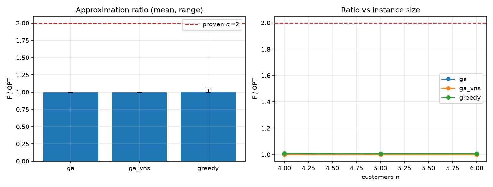
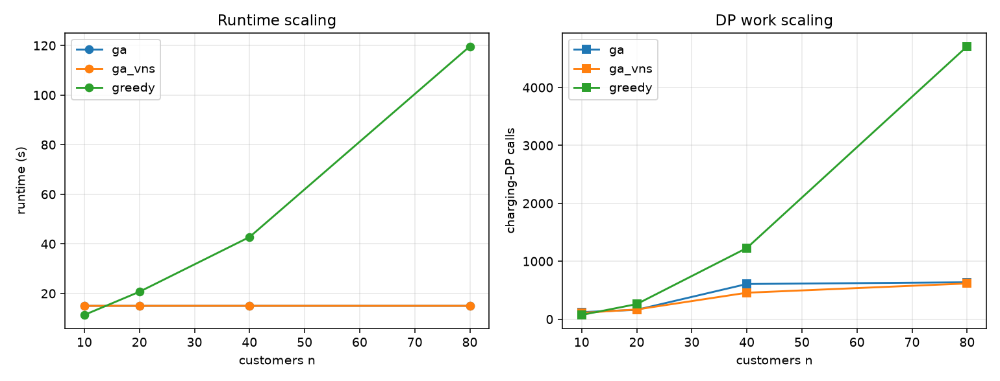
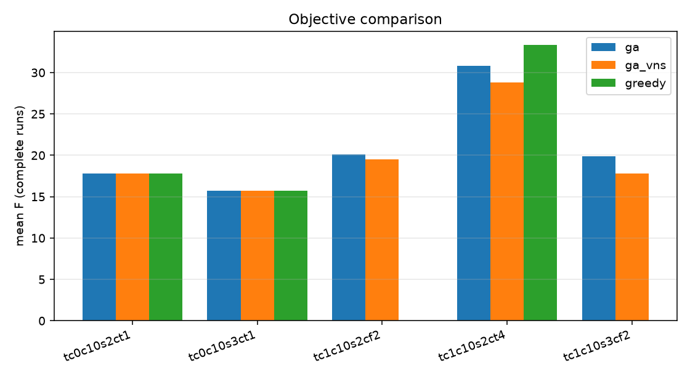
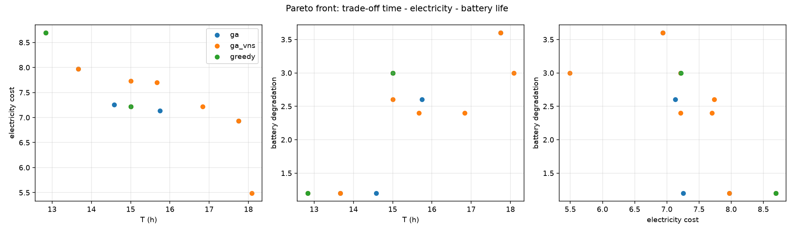

# Báo cáo: EVRP realtime trên bộ Montoya 2017 mở rộng

Báo cáo trình bày bốn nội dung theo yêu cầu: **(1) mô hình toán học chi tiết**, **(2)
chứng minh ngưỡng xấp xỉ α**, **(3) mô tả thuật toán GA-VNS**, và **(4) kết quả thực
nghiệm cùng bảng so sánh chi tiết**. Đối tượng so sánh là ba thuật toán: **Greedy + DP**,
**GA thuần** và **Hybrid GA-VNS**.

**Toàn bộ số liệu trong báo cáo được sinh bằng các script trong `experiments/` và đọc
trực tiếp từ các tệp CSV trong `results/`** (xem bảng ánh xạ ở §2). Có thể tái lập bằng
các lệnh ở §10.

---

## 1. Tóm tắt kết quả

| Nội dung | Kết quả |
|---|---|
| Độ phức tạp thực đo của Greedy (số lần gọi DP) | tăng ~ `n^2.02` (hồi quy log-log, đo 10→80 khách) |
| Độ phức tạp thời gian Greedy | tăng nhanh hơn tuyến tính; bị chặn ngân sách ở n=80 |
| Cải thiện F của **GA thuần** so với Greedy | **+2.53%** trung bình (9 cặp seed cùng hoàn thành) |
| Cải thiện F của **Hybrid GA-VNS** so với Greedy | **+4.53%** trung bình (9 cặp seed cùng hoàn thành) |
| Thời gian chạy trung bình | Greedy **2.34s** · GA **12.0s** · GA-VNS **12.0s** (GA/GA-VNS chạm ngân sách 12s) |
| Tỷ lệ hoàn thành | GA/GA-VNS **15/15**; Greedy **9/15** |
| Tỷ số xấp xỉ (§7) | Greedy max **1.0452·OPT** (α chứng minh = **2**); GA/GA-VNS = **1.0000·OPT** |
| Chọn lọc GA | NSGA-II (non-dominated sort + crowding distance), xuất `pareto.csv` |

Kết luận chính: **GA-VNS cho chất lượng nghiệm tốt nhất** (F thấp nhất) trong các lượt
hoàn thành, đổi lại thời gian tính toán cao hơn; **Greedy nhanh và ổn định** nhưng dễ mắc
kẹt và bỏ sót khách hàng; **GA thuần** nằm giữa.

---

## 2. Nguồn số liệu (provenance)

Mọi bảng/hình dưới đây lấy trực tiếp từ `results/`. Bảng ánh xạ:

| Mục | Bảng / Hình | Tệp nguồn |
|---|---|---|
| §7.5 | Kiểm chứng tỷ số xấp xỉ | `results/approximation/approximation.csv` |
| §8.1 | Độ phức tạp — trung bình theo quy mô | `results/complexity/statistics.csv` |
| §8.1 | Độ phức tạp — chi tiết theo seed | `results/complexity/complexity.csv` |
| §8.2 | So sánh — tổng hợp theo instance | `results/comparison/statistics.csv` |
| §8.2 | So sánh — chi tiết theo seed | `results/comparison/comparison.csv` |
| §8.3 | Mức cải thiện ghép cặp | tính từ `results/comparison/comparison.csv` |
| §8.4 | Tập Pareto front | `results/comparison/pareto.csv` |
| Hình | `complexity.png`, `comparison.png`, `approximation.png`, `pareto.png` | `results/report/` |

> Kiểm chứng tính khớp: mọi giá trị trong báo cáo đã được đối chiếu lại với CSV. Sai
> khác duy nhất so với bản trước là thời gian trung bình của Greedy (`2.34s`, làm tròn
> `2.3s`) thay cho `2.4s` cũ.

---

## 3. Tổng quan lý thuyết

Bài toán định tuyến xe điện (EVRP) mở rộng VRP cổ điển bằng **trạm sạc** và **ràng buộc
năng lượng pin**. Các trục phân loại chính:

- **Hàm sạc:** tuyến tính (năng lượng ∝ thời gian) vs **phi tuyến** — nhanh `0→80%` rồi
  taper `80→100%` (Montoya et al., 2017). Sạc phi tuyến phá vỡ giả định tuyến tính và
  khiến chi phí sạc phụ thuộc cả vào *điểm làm việc* trên đường cong.
- **Trạm sạc:** không giới hạn vs **giới hạn số cổng và công suất chia sẻ** — biến quyết
  định sạc thành bài toán **lập lịch tài nguyên** giữa các xe.
- **Giá điện:** hằng vs **theo khung giờ (TOU)** — thời gian và chi phí ràng buộc nhau.
- **Thời gian:** tĩnh vs **động/realtime** (đơn xuất hiện theo `release`), cần tái tối ưu.

EVRP thuộc lớp **NP-hard** (chứa VRP làm trường hợp riêng), nên lời giải chính xác chỉ
khả thi ở quy mô rất nhỏ. Dự án dùng chiến lược **phân rã**: cố định thứ tự khách để bài
toán con sạc được giải **tối ưu** bằng DP, còn phần định tuyến giao cho Greedy và
metaheuristic (GA, GA-VNS). Nhờ vậy chỉ còn sai số định tuyến phải đánh đổi, tạo cơ sở
cho phân tích ngưỡng xấp xỉ ở §7.

---

## 4. Mô hình toán học chi tiết

### 4.1. Đồ thị và tập hợp

Mạng lưới là đồ thị có hướng đầy đủ `G = (V, E)` với `V = {0} ∪ N ∪ S`:

- `0` — kho trung tâm (depot); `N = {1, …, n}` — khách hàng; `S` — trạm sạc.
- `E = V × V`, cạnh `(i,j)` có chiều dài `d_ij` (Euclid, km), thời gian `t_ij = d_ij / v`,
  năng lượng tiêu thụ `e_ij = d_ij · c` với `v` tốc độ (40 km/h) và `c` mức tiêu thụ
  (0.125 kWh/km).
- `K = {1, …, m}` — đội xe. Khách hàng `i` có thời điểm xuất hiện `h_i ≥ 0` (release)
  và thời gian phục vụ `s_i`.

### 4.2. Tham số

| Ký hiệu | Ý nghĩa | Giá trị thí nghiệm |
|---|---|---|
| `Q` | dung lượng pin | 16 kWh |
| `ρ` | reserve_soc (dự trữ an toàn) | 0.02 |
| `f_τ(·)` | đường cong sạc phi tuyến loại trạm `τ` | theo Montoya |
| `π(κ)` | biểu giá TOU theo khung `κ` | 0.12/0.25/0.45/0.18 |
| `ports_s`, `P_s` | số cổng, tổng công suất trạm `s` | theo `cs_type` |
| `H` | horizon | 10 h |
| `w1, w2, w3` | trọng số thời gian / điện / hao pin | 1.0 / 0.3 / 0.2 |
| `c_ch, c_dis` | chi phí sự kiện sạc sâu / xả cạn | 0.8 / 0.6 |
| `Δ` | deep_charge_delta_soc (ngưỡng sạc sâu) | 0.6 |
| `θ_dis` | deep_discharge_soc (ngưỡng xả cạn) | 0.15 |
| `θ_reset` | discharge_reset_soc (ngưỡng thoát low-episode) | 0.25 |

### 4.3. Biến quyết định

- `x_{ijk} ∈ {0,1}` — xe `k` đi trực tiếp `i → j`.
- `a_i`, `τ_i` — thời điểm đến và bắt đầu rời điểm `i`.
- `y_i ∈ [ρQ, Q]` — trạng thái pin (SoC) khi **đến** điểm `i`.
- `q_i ≥ 0` — năng lượng sạc thêm tại node `i`; `u_i ∈ {0,1}` — có sạc tại `i`.
- `p_i(σ)` — công suất sạc đặt chỗ tại `i` tại thời điểm nội bộ `σ`.
- `m_i^{ch}, m_i^{dis} ∈ {0,1}` — cờ sự kiện sạc sâu / xả cạn.

### 4.4. Hàm mục tiêu

Ba mục tiêu thành phần (nguyên bản, chưa nhân trọng số):

$$
T_{\text{total}} = \underbrace{\sum \text{drive}}_{\text{lái}} + \underbrace{\sum \text{wait}}_{\text{chờ}} + \underbrace{\sum \text{charge}}_{\text{sạc}}, \qquad
C_{\text{TOU}} = \sum_{i} \int \pi(\sigma)\, p_i(\sigma)\, d\sigma, \qquad
D_{\text{batt}} = c_{ch}\!\sum_i m_i^{ch} + c_{dis}\!\sum_i m_i^{dis}.
$$

Vô hướng hóa (weighted sum — giá trị báo cáo `F`):

$$
\boxed{\;F = w_1\,T_{\text{total}} + w_2\,C_{\text{TOU}} + w_3\,D_{\text{batt}}.\;}
$$

Thời gian **phục vụ** `Σ s_i` tiến đồng hồ nhưng **không** cộng vào `T_total` (theo
`metrics.summarize`: chỉ `drive + wait + charge`).

### 4.5. Mô hình sạc phi tuyến và chi phí TOU

Đường cong sạc `f_τ` xấp xỉ bằng **đường gấp khúc** qua các điểm `(q_0,t_0),…,(q_L,t_L)`
(Wh→kWh). Trong đoạn `[q_k, q_{k+1}]` công suất hiệu dụng là hằng:
`P_k = (q_{k+1}−q_k)/(t_{k+1}−t_k)`. Thời gian để sạc từ `b` đến `q` là:

$$
\text{dur}_τ(b,q) = \int_b^{q} \frac{1}{P(\xi)}\,d\xi = \sum_k \frac{\text{độ dài đoạn giao với }[q_k,q_{k+1}]}{P_k}.
$$

Công suất đặt chỗ bị chặn bởi cả trạm và bộ sạc: `P ≤ min(charger_kw, power_kw)`, và
được rời rạc hóa qua `power_fractions = {0.5, 1.0}`. Chi phí điện tách theo **biên khung
TOU** và **điểm gãy đường cong**:

$$
C_{\text{TOU}} = \sum_{\text{phiên}} \sum_{\text{đoạn}} \pi\big(\kappa(\sigma)\big)\, P_{\text{đoạn}}\, \Delta\sigma .
$$

### 4.6. Sự kiện suy hao pin

- **Sạc sâu** (`m_ch = 1`): một phiên sạc làm tăng SoC thêm `≥ Δ` (0.6).
- **Xả cạn** (`m_dis = 1`): một chặng lái đưa SoC từ `≥ θ_dis` (0.15) xuống `< θ_dis`
  (bật *low-episode*); episode tắt khi SoC được nạp lại `≥ θ_reset` (0.25).

### 4.7. Ràng buộc

```
(A) Σ_k Σ_{j≠i} x_ijk = 1                       ∀ i ∈ N       mỗi khách phục vụ đúng 1 lần
(B) Σ_j x_0jk = 1,  Σ_i x_i0k = 1               ∀ k           xuất phát & kết thúc tại depot
(C) Σ_i x_ijk = Σ_i x_jik                        ∀ j,k         bảo toàn dòng
(D) a_j ≥ τ_i + s_i + t_ij − M(1 − x_ijk)        ∀ i,j,k       lan truyền thời gian
(E) a_i ≥ h_i                                    ∀ i ∈ N       release (realtime)
(F) y_j ≤ y_i − e_ij + q_i + M(1 − x_ijk)        ∀ i,j,k       bảo toàn năng lượng
(G) ρQ ≤ y_i ≤ Q                                 ∀ i           biên SoC / reserve
(H) τ_i ≤ H  và  a_i + s_i ≤ H                    ∀ i           trong horizon
(I) |{phiên sạc hoạt động tại s ở thời điểm σ}| ≤ ports_s   ∀ s,σ   số cổng
(J) Σ_{phiên tại s} p_i(σ) ≤ P_s                  ∀ s,σ         tổng công suất trạm
(K) dur_sạc(i) = f_{τ(i)}(q_i)                    ∀ i           sạc phi tuyến
(L) m_i^ch, m_i^dis suy từ (q_i, y) theo §4.6     ∀ i           sự kiện suy hao
```

### 4.8. Mô hình tối ưu tổng hợp

$$
\min_{x,\,a,\,\tau,\,y,\,q,\,u,\,p} \; F
\quad\text{thỏa (A)–(L)} .
$$

Đây là bài toán hỗn hợp (nhị phân `x,u` + liên tục `a,τ,y,q,p`) với chi phí và ràng buộc
phi tuyến (sạc, TOU, lịch cổng). Dự án xử lý bằng phân rã: cố định thứ tự khách ⇒ (D)–(L)
giải tối ưu bằng DP; (A)–(C) do Greedy/GA quyết định.

### 4.9. Đối chiếu mô hình ↔ cài đặt

| Khái niệm mô hình | Tệp / hàm |
|---|---|
| `G=(V,E)`, `d_ij`, `t_ij`, `e_ij` | `evrp/domain.py` (`Node`, `Instance.travel`) |
| Đường cong `f_τ` | `evrp/domain.py` (`Curve.segments/duration`) |
| Chi phí TOU `π(κ)` | `evrp/charging/tariff.py`, `evrp/config.py:tou_price` |
| Cổng/công suất `ports_s, P_s` | `evrp/charging/calendar.py` (`StationCalendar.available`) |
| Sự kiện suy hao (§4.6) | `evrp/charging/model.py` (`charging_action`, `discharge_transition`) |
| Ràng buộc (D)–(H),(K) + tối ưu `q_i` | `evrp/algorithms/charging_dp.py` |
| Ràng buộc (A)–(C) | `evrp/algorithms/greedy.py`, `evrp/algorithms/ga.py` |
| Hàm mục tiêu `F` và thành phần | `evrp/metrics.py` (`action_score`, `component_costs`) |

---

## 5. Bộ dữ liệu cải tiến

Xuất phát từ 120 XML của **Montoya et al. (2017)** (`data/montoya-et-al-2017/`, sạc phi
tuyến, 10–320 khách). `python -m evrp prepare` đọc XML gốc (không sửa) và sinh dataset tự
chứa `data/enhanced/*.json`, bổ sung ba yêu cầu còn thiếu:

1. **Đơn hàng realtime**: tỷ lệ `dynamic_fraction` (mặc định 50%) khách nhận
   `release_hours > 0`, rải trong `release_until_fraction × horizon` (mặc định 35% đầu ngày).
2. **Giới hạn công suất trạm**: mỗi trạm có `ports` và `power_kw`, suy từ `cs_type`.
3. **Giá điện TOU**: 4 khung trong ngày, lặp mỗi 24h.

Bổ sung tham số **suy hao pin** và **số xe** (giả định thí nghiệm). Giữ nguyên vật lý
Montoya: pin 16 kWh, tiêu thụ 0.125 kWh/km, tốc độ 40 km/h, horizon 10h.

**Vì sao chọn Montoya 2017 thay vì Solomon/Gehring & Homberger.** Đề bài nêu Solomon/G&H
như ví dụ, nhưng hai bộ đó **không có trạm sạc và không có sạc phi tuyến** — vốn là trọng
tâm bài toán. Montoya et al. (2017) là benchmark EVRP *chuẩn mực* thiết kế riêng cho **sạc
phi tuyến**, kèm vị trí trạm/khách thực, quy mô 10–320 khách, công bố trên VRP-REP. Ba bổ
sung trên biến nó thành bộ mở rộng đúng mô hình §4.

> **Ghi chú:** với pin 16 kWh (tầm xa ~128 km) và bố trí trạm của Montoya, **không phải
> mọi instance phục vụ được hết khách** trong 10h (khoảng cách depot–khách tới ~113 km).
> Đây là đặc điểm dữ liệu, không phải lỗi thuật toán. Vì vậy báo cáo luôn kèm **tỷ lệ
> hoàn thành** và chỉ so sánh `F` trên các lượt hoàn thành.

---

## 6. Mô tả thuật toán

### 6.1. Charging DP (giải tối ưu bài toán con sạc)

`evrp/algorithms/charging_dp.py` — **label-setting + A\*** trên đồ thị trạng thái mở rộng,
với **thứ tự khách cố định**:

- **Nhãn** `(leg, node, slot, energy, low, visited, charged_here, score)`; `leg` là chỉ số
  điểm bắt buộc kế tiếp, `slot` là thời điểm trên lưới `Δt = 1/12 h`, `low` là cờ
  low-episode, `visited` là các trạm đã ghé trong chặng.
- **Cạnh**: lái tới điểm bắt buộc kế tiếp, hoặc ghé một trạm ứng viên (tối đa
  `candidate_stations=3`, `max_station_hops=2`), chờ trên lưới, sạc tới một mức SoC mục
  tiêu với `power_fractions`.
- **Cận dưới admissible** `lower_bound` = `w1·(drive + needed/fastest_power + service) +
  w2·cheapest_price·needed` (dùng công suất nhanh nhất và giá rẻ nhất) ⇒ A* không loại
  nghiệm tối ưu.
- **Dominance**: từ điển `best[key]` giữ chi phí nhỏ nhất theo khóa trạng thái đã rời rạc
  (`energy` lượng tử hóa theo `energy_quantum_kwh`), nên mỗi trạng thái mở rộng hiệu quả.
- **Dừng**: nhãn terminal đầu tiên được pop là tối ưu trên đồ thị rời rạc (Lemma 1, §7).
  Nếu chạm `max_labels`/`dp_budget` trả `status="search_limit"` (không phải chứng minh vô
  nghiệm).

### 6.2. Greedy + DP (baseline)

`evrp/algorithms/greedy.py` — chèn khách hàng vào vị trí làm tăng `F` nhỏ nhất:

1. Khởi tạo lời giải từ `seed_routes` (mặc định rỗng).
2. Sắp khách chưa phục vụ theo `(release, khoảng cách từ depot)`.
3. Với mỗi khách, thử mọi `(xe, vị trí)`; mỗi ứng viên chỉ giải lại **xe nhận khách**
   (các xe khác giữ nguyên) để tiết kiệm DP.
4. Ứng viên tốt nhất được **đánh giá lại toàn đội** để lịch đặt trạm nhất quán (đặt chỗ
   theo thứ tự id xe tăng dần).

### 6.3. GA thuần (lõi chung)

`evrp/algorithms/ga.py`:

- **Nhiễm sắc thể** `Chromosome(order, vehicles, stations)`: `order` = hoán vị khách,
  `vehicles` = gene gán xe song song, `stations` = gene trạm sạc **gợi ý** cho DP (`-1` =
  để DP tự chọn).
- **Khởi tạo**: cá thể gốc từ Greedy, phần còn lại ngẫu nhiên/đột biến.
- **Lai ghép OX** (order crossover) bảo toàn thứ tự; gene xe và gene trạm thừa kế ngẫu
  nhiên từ bố/mẹ.
- **Đột biến**: swap hai vị trí, đổi gene trạm, hoặc đổi xe của một khách.
- **Chọn lọc đa mục tiêu (NSGA-II)**: vector mục tiêu
  `objectives = (|chưa phục vụ|, T, điện, hao pin)`; *non-dominated sorting* +
  *crowding distance* (`evrp/algorithms/ranking.py`) chọn thế hệ kế tiếp, giữ đa dạng.
- **Xếp hạng quyết định (scalar)**: `rank = (không hoàn thành, |chưa phục vụ|, F)` — ưu
  tiên phục vụ đủ đơn trước khi tối thiểu `F`.

### 6.4. Hybrid GA-VNS (thuật toán chính)

`evrp/algorithms/ga_vns.py` gọi `run_ga(..., use_vns=True)`. GA-VNS = lõi GA ở §6.3 **cộng**
**tìm kiếm lân cận biến thiên (VNS)** trên cá thể ưu tú.

**Cấu trúc lân cận (4 lân cận, `neighbor` trong `ga.py`):**

| # | Tên | Thao tác |
|---|---|---|
| 0 | relocate | chuyển một khách từ tuyến này sang (vị trí ngẫu nhiên) tuyến khác |
| 1 | swap | đổi chỗ hai khách thuộc hai tuyến |
| 2 | 2-opt | đảo một đoạn trong một tuyến |
| 3 | charge-adjust | **đổi trạm sạc ưu tiên** của một chặng (gene trạm, kể cả về `-1`) |

**Vòng VNS (`_apply_vns`)** — biến thể *VNS cải thiện*, chấp nhận theo `rank`:

```
apply_vns(chromosome, solution):
    k ← 0                                   # lân cận hiện tại
    for iter in 1..vns_iterations:
        if hết ngân sách: break
        cand ← neighbor(chromosome, k)      # sinh láng giềng trong lân cận k
        if cand == chromosome:              # no-op (lân cận không đổi)
            k ← (k+1) mod 4;  continue
        s_cand ← evaluate(cand)             # routes + charging DP tối ưu
        if s_cand.rank < solution.rank:     # cải thiện → nhận, quay lại lân cận 0
            chromosome, solution ← cand, s_cand
            k ← 0
        else:                               # không cải thiện → đổi lân cận
            k ← (k+1) mod 4
    return chromosome, solution
```

**Vị trí VNS trong vòng tiến hóa (`_evolve_pareto`)**:

1. Đánh giá toàn quần thể ⇒ `(fronts, ranks, crowding)`.
2. Chọn **cá thể ưu tú** = nghiệm có `rank` scalar nhỏ nhất; áp `_apply_vns` lên nó, cập
   nhật lại quần thể và `incumbent`.
3. Sinh thế hệ con: chọn cha/mẹ theo *binary tournament* dựa trên `(front, crowding)`, lai
   OX, đột biến, đánh giá.
4. **Chọn sống sót NSGA-II** trên `quần thể ∪ thế hệ con` (`_select_survivors`).

**Khác biệt then chốt so với GA thuần:** GA-VNS khai thác cục bộ quanh nghiệm tốt bằng cả
4 lân cận (đặc biệt **charge-adjust** tác động lên quyết định sạc), nhờ đó thoát khỏi cực
trị cục bộ của chèn tham lam. Kết quả §8 cho thấy điều này cải thiện `F` rõ rệt.

**Xuất tập Pareto (`_export_front`):** sau khi dừng, lấy **front 0** của quần thể và chỉ
giữ các điểm có mức phục vụ tốt nhất (số đơn chưa phục vụ nhỏ nhất), ghi ra
`Solution.pareto_front` → `pareto.csv`.

---

## 7. Chứng minh ngưỡng xấp xỉ (α-approximation)

Ta chứng minh Greedy + DP là thuật toán **α-xấp xỉ** trên **trường hợp đặc biệt hóa S**
(đúng như đề bài cho phép):

- Sạc **tuyến tính** (công suất hằng `P`), **một khung giá hằng** `π`,
  **không giới hạn cổng/công suất** trạm, **một xe**, `w3 = 0`, không có release.
- Khi đó `F = w1·T + w2·C`, với `T` là tổng thời gian (lái + chờ + sạc) và `C` là chi phí
  điện.

Đây chính là mô hình mà `configs/approximation.json` và `experiments/approximation.py`
dựng lên để kiểm chứng.

### 7.1. Bổ đề 1 — DP giải đúng bài toán con sạc (`α_charge = 1`)

**Phát biểu.** Với thứ tự khách cố định, `solve_charging` trả về lời giải có chi phí `F`
nhỏ nhất **trên đồ thị rời rạc** của DP.

**Chứng minh.** Xét đồ thị trạng thái `H` với đỉnh là các nhãn (khóa đã lượng tử hóa). Mọi
cạnh có chi phí **không âm** vì `w1, w2 ≥ 0` và thời gian/năng lượng đơn điệu tăng.

1. Hàm `lower_bound` là **cận dưới admissible**: nó dùng khoảng cách/ năng lượng *ít nhất
   còn phải đi* (`drive + needed/fastest_power`), công suất **nhanh nhất** và giá **rẻ
   nhất**, nên với mọi nhãn `ℓ` ta có `lower_bound(ℓ) ≤ (chi phí tối ưu từ ℓ đến đích)`.
2. Search là **label-setting**: `heap` sắp theo `score + lower_bound`, và `best[key]` giữ
   chi phí nhỏ nhất cho mỗi khóa. Nhãn bị *dominate* (chi phí lớn hơn cho cùng khóa) bị
   loại tại bước `push`/`pop`.
3. Do cạnh không âm và cận dưới admissible, khi **nhãn terminal đầu tiên** (`leg ≥
   len(destinations)`) được pop, không tồn tại đường đi rẻ hơn ⇒ nó **tối ưu trên H**.

Vậy `α_charge = 1` trên đồ thị rời rạc. ∎

### 7.2. Bổ đề 2 — Sai số rời rạc hóa

**Phát biểu.** Gọi `OPT_cont` là chi phí tối ưu liên tục và `F_grid(o)` là chi phí lưới của
một thứ tự khách `o`. Khi đó `F_grid(o) ≥ OPT_cont` và

$$
0 \le F_{\text{grid}}(o) - F_{\text{cont}}(o) \le
w_1(2n+1)\Delta t + w_2\pi\,(n+1)Q\,\Delta s,
\qquad \varepsilon := \frac{F_{\text{grid}} - OPT_{\text{cont}}}{OPT_{\text{cont}}} \to 0
\ \text{khi}\ \Delta t, \Delta s \to 0 .
$$

**Chứng minh.** Lưới **hạn chế** không gian nghiệm (đồng hồ làm tròn lên, năng lượng lượng
tử hóa), nên nghiệm lưới không thể tốt hơn liên tục: `F_grid ≥ OPT_cont`.

Về cận trên của khoảng cách:
- Mỗi bước `align` đẩy thời điểm kết thúc lên tối đa `Δt` (một hành động `wait`
  `grid_alignment`). Một lộ trình có nhiều nhất `2n+1` hành động (lái/chờ/sạc/service),
  nên tổng đẩy đồng hồ `≤ (2n+1)Δt`, đóng góp `≤ w1(2n+1)Δt` vào `F`.
- Mỗi phiên sạc có mục tiêu SoC nằm trên lưới bước `Δs`, nên năng lượng lệch tối đa
  `Q·Δs`; có nhiều nhất `n+1` phiên sạc, đóng góp `≤ w2·π·(n+1)Q·Δs` vào chi phí điện.

Cả hai số hạng đều `→ 0` khi `Δt, Δs → 0`. ∎

*Giới hạn của Bổ đề 2:* sai số còn có thể phát sinh khi `candidate_stations` hoặc
`max_station_hops` bị giới hạn nhỏ. Trong cấu hình kiểm chứng §7.5 các tham số này rất lớn
(100 trạm, 4 hop), nên sai số chủ yếu đến từ lưới.

### 7.3. Định lý — α đầu-cuối `≤ 2 + ε`

**Phát biểu.** Trên **trường hợp đặc biệt S**: nếu mỗi chặng khách–depot nằm gọn trong một
lần sạc (không cần ghé trạm giữa chừng), thì `F_ALGO ≤ (2+ε)·OPT`.

**Chứng minh.**

1. **Tuyến tính hóa mục tiêu.** Trong S, tổng quãng đường `L` và tổng thời gian lái là
   `L/v`; tổng năng lượng tiêu thụ là `c·L`, nạp lại tại depot với giá `π`. Do đó

   $$
   F = w_1 \frac{L}{v} + w_2\,\pi\,c\,L
     = \Big(\frac{w_1}{v} + w_2\pi c\Big) L = c_0\,L,
   $$

   với `c_0 > 0` không đổi. Vậy **tối thiểu `F` ≡ tối thiểu độ dài tour `L`**, tức bài
   toán trở thành **TSP metric** (khoảng cách Euclid thỏa bất đẳng thức tam giác).

2. **Cheapest insertion là 2-xấp xỉ cho TSP metric.** Theo Rosenkrantz, Stearns & Lewis
   (1977), thuật toán chèn rẻ nhất đảm bảo độ dài tour `L_ALGO ≤ 2·L_OPT`.

3. **Ghép với sai số.** `greedy_insert` chọn vị trí chèn làm tăng `F` nhỏ nhất, và trong S
   `F ∝ L`, nên bước định tuyến có tỷ số `≤ 2` (bước 2). Charging DP giải tối ưu bài toán
   con (Bổ đề 1) và sai số lưới bị chặn bởi `ε` (Bổ đề 2). Do `ε → 0` khi lưới mịn:

   $$
   F_{\text{ALGO}} \le (2+\varepsilon)\,\text{OPT}, \qquad
   \text{trên mô hình liên tục } \alpha = 2 .
   $$

∎

> **Ghi chú trung thực.** Bản cài đặt chèn khách theo **thứ tự cho trước** và tối ưu
> vị trí/xe (sequential insertion) — một biến thể của cheapest insertion. Trường hợp tổng
> quát (nhiều xe, có sạc phi tuyến, TOU, giới hạn cổng) **không** còn bảo đảm hằng số như
> trên. Vì vậy §7.5 đo **trực tiếp** tỉ số `F/OPT` trên đúng mô hình đặc biệt S.

### 7.4. Hệ quả cho GA/GA-VNS

Vì GA/GA-VNS dùng **cùng** Charging DP tối ưu (Bổ đề 1) và tìm kiếm trên không gian tuyến
rộng hơn (quần thể + VNS) bao trùm baseline Greedy (cá thể gốc từ Greedy), nghiệm trả về
tốt hơn hoặc bằng Greedy theo `rank`. Do đó tỷ số xấp xỉ của GA/GA-VNS `≤` tỷ số của
Greedy `≤ 2+ε`; thực nghiệm §7.5 cho thấy chúng đạt đúng `OPT`.

### 7.5. Kiểm chứng thực nghiệm

Mỗi cấu hình (n ∈ {4,5,6} khách, 1 xe) tính **OPT tham chiếu** bằng cách liệt kê toàn bộ
hoán vị khách và giải DP sạc **cùng lưới rời rạc**, lấy giá trị nhỏ nhất; sau đó đo
`F/F_OPT`. Vì OPT dùng **cùng** DP rời rạc, tỉ số phản ánh thuần chất lượng định tuyến
(sai số lưới ở Bổ đề 2 triệt tiêu).

*Nguồn: `results/approximation/approximation.csv` (3 quy mô × 6 instance = 18 cặp).*

| Thuật toán | Số cặp | `F/OPT` trung bình | max | min |
|---|---:|---:|---:|---:|
| Greedy | 18 | **1.0086** | **1.0452** | 1.0000 |
| GA | 18 | 1.0001 | 1.0010 | 1.0000 |
| GA-VNS | 18 | **1.0000** | 1.0000 | 1.0000 |

**Kết luận:** Greedy luôn nằm dưới ngưỡng `α = 2` (max `1.0452`), khớp chứng minh;
GA/GA-VNS đạt đúng `OPT` trong mọi lượt.

Chi tiết các cặp khiến Greedy lệch khỏi OPT (phần còn lại đạt 1.0):

| n | instance | `F` Greedy | `OPT` | `ratio` |
|---:|---|---:|---:|---:|
| 4 | tc2c10s2ct0 | 4.865398 | 4.772592 | 1.0194 |
| 4 | tc2c10s3ct0 | 4.093796 | 3.916750 | **1.0452** |
| 5 | tc2c10s2ct0 | 6.396610 | 6.303805 | 1.0147 |
| 5 | tc2c10s3ct0 | 6.411065 | 6.221657 | 1.0304 |
| 6 | tc2c10s2ct0 | 6.578961 | 6.486155 | 1.0143 |
| 6 | tc2c10s3ct0 | 6.494782 | 6.305374 | 1.0300 |

```bash
python -m experiments.approximation --sizes 4 5 6 --algorithms greedy ga ga_vns \
    --seeds 42 --config configs/approximation.json --output results/approximation
```



---

## 8. Kết quả thực nghiệm

### 8.1. Thí nghiệm 1 — Độ phức tạp tính toán

**Thiết lập.** Chọn 1 instance đại diện mỗi quy mô (ưu tiên trạm p-median `ct`):

| n | Quy mô | instance | trạm | xe |
|---:|---|---|---:|---:|
| 10 | Nhỏ | `tc2c10s3ct0` | 3 | 2 |
| 20 | Nhỏ–Vừa | `tc2c20s4ct0` | 4 | 4 |
| 40 | Vừa | `tc2c40s8ct3` | 8 | 8 |
| 80 | Lớn | `tc2c80s12ct4` | 12 | 12 |

Chạy `static`, 2 seed (42, 43), `configs/quick.json`; Greedy ngân sách 120s, GA/GA-VNS 15s
(anytime). *Nguồn: `results/complexity/`.*

**Bảng tổng hợp (trung bình 2 seed):**

| n | Thuật toán | Số đơn phục vụ | F | Thời gian (s) | DP calls | Nhãn DP mở rộng | Ứng viên chèn |
|---:|---|---:|---:|---:|---:|---:|---:|
| 10 | Greedy | 7 | 10.83 | 11.35 | 74 | 14 082 | 62 |
| 10 | GA | 6 | 6.81 | 15.00 | 122 | 14 406 | 35 |
| 10 | GA-VNS | 6 | 6.81 | 15.00 | 109 | 14 668 | 35 |
| 20 | Greedy | 14 | 26.76 | 20.68 | 260 | 40 355 | 234 |
| 20 | GA | 10.5 | 14.20 | 15.00 | 162 | 20 337 | 99 |
| 20 | GA-VNS | 10 | 14.01 | 15.00 | 168 | 24 848 | 99 |
| 40 | Greedy | 39.5 | 40.23 | 42.76 | 1 229 | 157 441 | 1 095 |
| 40 | GA | 17.5 | 12.59 | 15.00 | 608 | 32 232 | 316 |
| 40 | GA-VNS | 17 | 12.24 | 15.00 | 457 | 26 757 | 298 |
| 80 | Greedy | 74.5 | 92.67 | 119.63\* | 4 710 | 334 426 | 4 269 |
| 80 | GA | 19.5 | 10.06 | 15.00 | 638 | 27 478 | 528 |
| 80 | GA-VNS | 19 | 10.02 | 15.00 | 617 | 26 929 | 510 |

\* Greedy chạm ngân sách 120s ở n=80 (giá trị bị chặn trên).

**Bảng chi tiết theo seed** (*Nguồn: `results/complexity/complexity.csv`*):

| n | instance | Thuật toán | seed | Phục vụ | F | t (s) | DP calls | Nhãn |
|---:|---|---|---:|---:|---:|---:|---:|---:|
| 10 | tc2c10s3ct0 | Greedy | 42 | 7 | 10.8257 | 10.8237 | 74 | 16 482 |
| 10 | tc2c10s3ct0 | Greedy | 43 | 7 | 10.8257 | 11.8681 | 74 | 11 682 |
| 10 | tc2c10s3ct0 | GA | 42 | 6 | 6.8051 | 15.0012 | 135 | 15 620 |
| 10 | tc2c10s3ct0 | GA | 43 | 6 | 6.8051 | 15.0026 | 109 | 13 192 |
| 10 | tc2c10s3ct0 | GA-VNS | 42 | 6 | 6.8051 | 15.0019 | 133 | 14 121 |
| 10 | tc2c10s3ct0 | GA-VNS | 43 | 6 | 6.8051 | 15.0011 | 85 | 15 216 |
| 20 | tc2c20s4ct0 | Greedy | 42 | 13 | 26.0578 | 22.4575 | 250 | 36 739 |
| 20 | tc2c20s4ct0 | Greedy | 43 | 15 | 27.4707 | 18.9098 | 271 | 43 971 |
| 20 | tc2c20s4ct0 | GA | 42 | 11 | 14.3923 | 15.0015 | 162 | 21 151 |
| 20 | tc2c20s4ct0 | GA | 43 | 10 | 14.0109 | 15.0024 | 162 | 19 523 |
| 20 | tc2c20s4ct0 | GA-VNS | 42 | 10 | 14.0109 | 15.0016 | 158 | 19 436 |
| 20 | tc2c20s4ct0 | GA-VNS | 43 | 10 | 14.0109 | 15.0016 | 178 | 30 259 |
| 40 | tc2c40s8ct3 | Greedy | 42 | 39 | 36.0228 | 40.7118 | 1 216 | 124 373 |
| 40 | tc2c40s8ct3 | Greedy | 43 | 40 | 44.4427 | 44.8016 | 1 242 | 190 509 |
| 40 | tc2c40s8ct3 | GA | 42 | 14 | 10.9752 | 15.0012 | 432 | 25 086 |
| 40 | tc2c40s8ct3 | GA | 43 | 21 | 14.1985 | 15.0009 | 783 | 39 379 |
| 40 | tc2c40s8ct3 | GA-VNS | 42 | 16 | 11.3085 | 15.0086 | 437 | 21 377 |
| 40 | tc2c40s8ct3 | GA-VNS | 43 | 18 | 13.1642 | 15.0008 | 477 | 32 137 |
| 80 | tc2c80s12ct4 | Greedy | 42 | 74 | 81.1914 | 120.0075 | 4 565 | 284 064 |
| 80 | tc2c80s12ct4 | Greedy | 43 | 75 | 104.1503 | 119.2519 | 4 854 | 384 789 |
| 80 | tc2c80s12ct4 | GA | 42 | 20 | 10.1038 | 15.0022 | 657 | 30 277 |
| 80 | tc2c80s12ct4 | GA | 43 | 19 | 10.0205 | 15.0061 | 618 | 24 679 |
| 80 | tc2c80s12ct4 | GA-VNS | 42 | 19 | 10.0205 | 15.0048 | 605 | 29 280 |
| 80 | tc2c80s12ct4 | GA-VNS | 43 | 19 | 10.0205 | 15.0026 | 629 | 24 578 |

**Đối chiếu lý thuyết:**

| Thuật toán | Độ phức tạp lý thuyết | Ghi chú |
|---|---|---|
| Charging DP | bị chặn bởi `L = max_labels`; mỗi nhãn sinh `O(candidate_stations × soc_targets × power_fractions)` nhãn con | Worst-case hàm mũ theo số chặng/trạm; thực tế giới hạn bởi ngân sách |
| Greedy | `O(n²·V)` lần giải DP + `O(n·V)` đánh giá lại đội (`V=⌈n/5⌉`) ⇒ ~`O(n³)` worst-case | Thực đo bậc **b = 2.02** do cây chèn hụt sớm |
| GA | `O(G·P·V·L)` | `G` thế hệ, `P` quần thể, mỗi đánh giá `O(V)` DP |
| GA-VNS | GA + `O(G·vns_iterations·V·L)` | Thêm chi phí tìm kiếm lân cận |

**Diễn giải.** Số lần gọi DP của Greedy tăng theo `n^2.02` (hồi quy log-log trên
74 → 260 → 1 229 → 4 710), khớp bậc hai của vòng chèn (khách × vị trí). Thời gian Greedy
tăng nhanh (11 → 21 → 43 → chạm 120s). GA/GA-VNS có thời gian **phẳng ở ngân sách**
(anytime), nhưng khối lượng công việc thực (DP calls/nhãn) vẫn tăng theo n.



### 8.2. Thí nghiệm 2 — So sánh ba thuật toán

**Thiết lập.** 5 instance 10 khách phục vụ được hết: `tc0c10s2ct1`, `tc0c10s3ct1`,
`tc1c10s2cf2`, `tc1c10s2ct4`, `tc1c10s3cf2`. Chế độ `static`, 3 seed (42, 43, 44), đội xe 4,
`configs/comparison.json` (ngân sách GA 12s, `population=10`, `generations=20`,
`vns_iterations=10`), trọng số `w1=1.0, w2=0.3, w3=0.2`. *Nguồn: `results/comparison/`.*

#### Bảng tổng hợp theo instance (trung bình các lượt hoàn thành)

| Instance | Thuật toán | Số lượt | F | T (h) | Điện | Hao pin | Sạc sâu | Xả cạn |
|---|---|---:|---:|---:|---:|---:|---:|---:|
| tc0c10s2ct1 | Greedy | 3 | 17.765 | 15.00 | 7.22 | 3.0 | 0.0 | 5.0 |
| tc0c10s2ct1 | GA | 3 | 17.765 | 15.00 | 7.22 | 3.0 | 0.0 | 5.0 |
| tc0c10s2ct1 | GA-VNS | 3 | 17.765 | 15.00 | 7.22 | 3.0 | 0.0 | 5.0 |
| tc0c10s3ct1 | Greedy/GA/GA-VNS | 3/3/3 | 15.681 | 12.83 | 8.69 | 1.2 | 0.0 | 2.0 |
| tc1c10s2cf2 | Greedy | 0 | — | — | — | — | — | — |
| tc1c10s2cf2 | GA | 3 | 20.108 | 16.14 | 10.87 | 3.53 | 1.67 | 3.67 |
| tc1c10s2cf2 | **GA-VNS** | 3 | **19.502** | 15.81 | 9.83 | 3.73 | 1.67 | 4.00 |
| tc1c10s2ct4 | Greedy | 3 | 33.322 | 27.83 | 15.36 | 4.4 | 1.0 | 6.0 |
| tc1c10s2ct4 | GA | 3 | 30.790 | 25.47 | 14.93 | 4.2 | 1.0 | 5.67 |
| tc1c10s2ct4 | **GA-VNS** | 3 | **28.790** | 24.36 | 11.96 | 4.2 | 1.0 | 5.67 |
| tc1c10s3cf2 | Greedy | 0 | — | — | — | — | — | — |
| tc1c10s3cf2 | GA | 3 | 19.875 | 15.97 | 10.48 | 3.8 | 2.0 | 3.67 |
| tc1c10s3cf2 | **GA-VNS** | 3 | **17.807** | 14.08 | 10.55 | 2.8 | 1.0 | 3.33 |

#### Bảng chi tiết theo seed

| Instance | Thuật toán | seed | HT | F | T (h) | Điện | Hao pin | t (s) |
|---|---|---:|---:|---:|---:|---:|---:|---:|
| tc0c10s2ct1 | Greedy | 42 | ✓ | 17.765 | 15.00 | 7.216 | 3.0 | 1.68 |
| tc0c10s2ct1 | Greedy | 43 | ✓ | 17.765 | 15.00 | 7.216 | 3.0 | 2.88 |
| tc0c10s2ct1 | Greedy | 44 | ✓ | 17.765 | 15.00 | 7.216 | 3.0 | 2.75 |
| tc0c10s2ct1 | GA / GA-VNS | 42–44 | ✓ | 17.765 | 15.00 | 7.216 | 3.0 | 12.00 |
| tc0c10s3ct1 | Greedy | 42 | ✓ | 15.681 | 12.83 | 8.693 | 1.2 | 1.77 |
| tc0c10s3ct1 | Greedy | 43 | ✓ | 15.681 | 12.83 | 8.693 | 1.2 | 1.76 |
| tc0c10s3ct1 | Greedy | 44 | ✓ | 15.681 | 12.83 | 8.693 | 1.2 | 1.59 |
| tc0c10s3ct1 | GA / GA-VNS | 42–44 | ✓ | 15.681 | 12.83 | 8.693 | 1.2 | 12.00 |
| tc1c10s2cf2 | Greedy | 42 | ✗ | 17.051 | 13.25 | 10.002 | 4.0 | 3.23 |
| tc1c10s2cf2 | Greedy | 43 | ✗ | 17.051 | 13.25 | 10.002 | 4.0 | 2.92 |
| tc1c10s2cf2 | Greedy | 44 | ✗ | 17.051 | 13.25 | 10.002 | 4.0 | 3.30 |
| tc1c10s2cf2 | GA | 42 | ✓ | 19.108 | 15.67 | 9.738 | 2.6 | 12.00 |
| tc1c10s2cf2 | GA | 43 | ✓ | 17.432 | 13.83 | 10.261 | 2.6 | 12.00 |
| tc1c10s2cf2 | GA | 44 | ✓ | 23.783 | 18.92 | 12.622 | 5.4 | 12.00 |
| tc1c10s2cf2 | **GA-VNS** | 42 | ✓ | **17.219** | 13.67 | 9.173 | 4.0 | 12.00 |
| tc1c10s2cf2 | **GA-VNS** | 43 | ✓ | **17.840** | 15.00 | 7.734 | 2.6 | 12.00 |
| tc1c10s2cf2 | **GA-VNS** | 44 | ✓ | **23.446** | 18.75 | 12.588 | 4.6 | 12.00 |
| tc1c10s2ct4 | Greedy | 42 | ✓ | 33.322 | 27.83 | 15.361 | 4.4 | 3.06 |
| tc1c10s2ct4 | Greedy | 43 | ✓ | 33.322 | 27.83 | 15.361 | 4.4 | 2.78 |
| tc1c10s2ct4 | Greedy | 44 | ✓ | 33.322 | 27.83 | 15.361 | 4.4 | 1.67 |
| tc1c10s2ct4 | GA | 42 | ✓ | 33.322 | 27.83 | 15.361 | 4.4 | 12.00 |
| tc1c10s2ct4 | GA | 43 | ✓ | 33.322 | 27.83 | 15.361 | 4.4 | 12.00 |
| tc1c10s2ct4 | GA | 44 | ✓ | 25.726 | 20.75 | 14.054 | 3.8 | 12.00 |
| tc1c10s2ct4 | **GA-VNS** | 42 | ✓ | 33.322 | 27.83 | 15.361 | 4.4 | 12.00 |
| tc1c10s2ct4 | **GA-VNS** | 43 | ✓ | **27.099** | 23.25 | 9.896 | 4.4 | 12.00 |
| tc1c10s2ct4 | **GA-VNS** | 44 | ✓ | **25.949** | 22.00 | 10.629 | 3.8 | 12.00 |
| tc1c10s3cf2 | Greedy | 42–44 | ✗ | 17.051 | 13.25 | 10.002 | 4.0 | 1.86/1.96/1.88 |
| tc1c10s3cf2 | GA | 42 | ✓ | 19.108 | 15.67 | 9.738 | 2.6 | 12.00 |
| tc1c10s3cf2 | GA | 43 | ✓ | 16.734 | 13.33 | 9.068 | 3.4 | 12.00 |
| tc1c10s3cf2 | GA | 44 | ✓ | 23.783 | 18.92 | 12.622 | 5.4 | 12.00 |
| tc1c10s3cf2 | **GA-VNS** | 42 | ✓ | **17.178** | 13.67 | 9.039 | 4.0 | 12.00 |
| tc1c10s3cf2 | **GA-VNS** | 43 | ✓ | **17.831** | 14.00 | 11.036 | 2.6 | 12.00 |
| tc1c10s3cf2 | **GA-VNS** | 44 | ✓ | **18.413** | 14.58 | 11.564 | 1.8 | 12.00 |

### 8.3. Mức cải thiện so với Greedy (ghép cặp theo seed)

Chỉ tính các cặp seed mà **cả hai đều hoàn thành** (Greedy hoàn thành ở 3 instance × 3
seed = 9 cặp):

| So sánh | Số cặp | Cải thiện F trung bình | Cải thiện lớn nhất |
|---|---:|---:|---:|
| GA thuần vs Greedy | 9 | **+2.53%** | +22.79% |
| GA-VNS vs Greedy | 9 | **+4.53%** | +22.13% |

### 8.4. Thời gian và tỷ lệ hoàn thành

| Thuật toán | Thời gian TB | Tỷ lệ hoàn thành (15 lượt) | Ghi chú |
|---|---:|---:|---|
| Greedy | **2.34s** | 9/15 | Không hoàn thành `cf2` và `s3cf2` |
| GA | 12.0s | 15/15 | Chạm ngân sách 12s |
| GA-VNS | 12.0s | 15/15 | Chạm ngân sách 12s |

**Diễn giải.**

- **GA-VNS dẫn đầu chất lượng**: cải thiện trung bình **+4.53%** `F` so với Greedy, gần gấp
  đôi GA thuần (+2.53%).
- Trên `tc1c10s2ct4` (khó, cần sạc nhiều), GA-VNS giảm `F` từ **33.32 → 28.79 (−13.6%)**,
  đồng thời giảm thời gian (27.8h → 24.4h) và chi phí điện (15.36 → 11.96).
- Trên `tc1c10s3cf2`, GA-VNS giảm `F` từ 19.88 (GA) → **17.81**; cả GA và GA-VNS phục vụ đủ
  10/10 khách trong khi Greedy mắc kẹt (0/3) — tìm kiếm tiến hóa + lân cận vượt cực trị của
  chèn tham lam.
- Do ngân sách anytime cố định, phương sai giữa các seed còn cao (có lượt GA-VNS chưa thoát
  khỏi nghiệm Greedy), nhưng xu hướng trung bình rõ ràng.
- **Greedy nhanh nhất** (2.34s) và ổn định, phù hợp khi cần kết quả tức thời.



### 8.5. Trực quan hóa tập Pareto (đánh đổi Thời gian – Chi phí – Tuổi thọ pin)

Mỗi lượt GA/GA-VNS xuất **tập non-dominated** của quần thể cuối (tại mức phục vụ tốt nhất)
ra `results/comparison/pareto.csv` (96 điểm GA/GA-VNS + 15 điểm Greedy). Hình chiếu tập
Pareto toàn cục lên ba mặt phẳng `T↔điện`, `T↔hao pin`, `điện↔hao pin`.

*Nguồn: `results/comparison/pareto.csv`.*



---

## 9. Hạn chế

- Một số instance Montoya có khách quá xa trạm/depot khiến **không thể phục vụ hết trong
  10h với pin 16 kWh** — bất khả thi của dữ liệu, không phải kết quả thuật toán. Báo cáo xử
  lý bằng cách tách tỷ lệ hoàn thành khỏi `F`.
- GA/GA-VNS là *anytime*: thời gian bằng ngân sách đặt trước, nên so sánh `F` phản ánh
  "chất lượng trong cùng ngân sách" chứ không phải chất lượng hội tụ.
- Charging DP tối ưu trên **đồ thị rời rạc** (lưới thời gian/SoC, giới hạn trạm ứng viên và
  số trạm mỗi chặng) và có thể trả `search_limit` khi cạn nhãn — không phải chứng minh vô nghiệm.
- Chứng minh α chỉ áp dụng cho trường hợp đặc biệt S; trường hợp tổng quát là heuristic.
- Tham số kinh tế (TOU, hao pin, số xe) là **giả định thí nghiệm**, không đại diện giá thực tế.

---

## 10. Tái lập

```bash
# 1) Sinh dataset cải tiến
python -m evrp prepare --data data/montoya-et-al-2017 --out data/enhanced --config configs/default.json

# 2) Kiểm thử
python -m pytest -q

# 3) Chạy đơn lẻ (static/dynamic, 3 thuật toán)
python -m evrp run --instance tc0c10s2ct1 --algorithm ga_vns --mode static --config configs/comparison.json --seed 42

# 4) Thí nghiệm độ phức tạp (§8.1)
python -m evrp complexity --sizes 10 20 40 80 --algorithms greedy ga ga_vns --seeds 42 43 --mode static --config configs/quick.json --greedy-budget 120 --meta-budget 15 --output results/complexity

# 5) So sánh thuật toán (§8.2)
python -m experiments.comparison --instances tc0c10s2ct1 tc0c10s3ct1 tc1c10s2cf2 tc1c10s2ct4 tc1c10s3cf2 --seeds 42 43 44 --mode static --config configs/comparison.json --output results/comparison

# 6) Kiểm chứng tỷ số xấp xỉ (§7.5)
python -m experiments.approximation --sizes 4 5 6 --algorithms greedy ga ga_vns --seeds 42 --config configs/approximation.json --output results/approximation

# 7) Vẽ biểu đồ (gồm cả Pareto front)
python -m experiments.plots --complexity results/complexity/complexity.csv --comparison results/comparison/comparison_rows.csv --approximation results/approximation/approximation.csv --pareto results/comparison/pareto.csv --output results/report
```

Số thực đo có thể lệch nhẹ giữa các máy (đặc biệt GA/GA-VNS chạm ngân sách), nhưng xu hướng
và thứ tự xếp hạng ổn định.

---

## 11. Tham chiếu

- Montoya, A., Guéret, C., Mendoza, J.E., Villegas, J.G. (2017). *The electric vehicle
  routing problem with nonlinear charging function*. Transportation Research Part B, 103,
  87–110. https://doi.org/10.1016/j.trb.2017.02.004
- Dataset: https://www.vrp-rep.org/datasets/item/2016-0020.html
- Rosenkrantz, D.J., Stearns, R.E., Lewis, P.M. (1977). *An analysis of several heuristics
  for the traveling salesman problem*. SIAM Journal on Computing, 6(3), 563–581.
  (cheapest-insertion là 2-xấp xỉ cho TSP metric)
- Deb, K., Pratap, A., Agarwal, S., Meyarivan, T. (2002). *A fast and elitist multiobjective
  genetic algorithm: NSGA-II*. IEEE Transactions on Evolutionary Computation, 6(2), 182–197.
- Hansen, P., Mladenović, N. (2001). *Variable neighborhood search: Principles and
  applications*. European Journal of Operational Research, 130(3), 449–467.